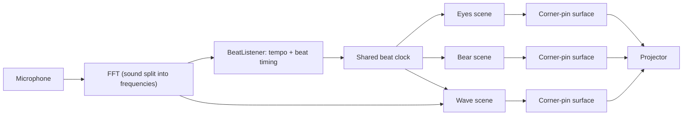

# Projection Mapping Halloween Show

A projection-mapped Halloween show built in [Processing](https://processing.org). It includes:

- **Animated eyes** on a poster. They blink, glance around, and follow a light show.
- **A dancing bear**: a hand-drawn bear head with a sketchy, furry body that dances.
- **A dancing zombie**: a picture cut into parts (head, torso, arms, legs) that dance.
- **A music waveform**: bars, lines or LED-style blocks that move with the sound.

Everything moves to the beat of whatever music is playing in the room. The Mac listens through its microphone and works out the tempo by itself.

The show was made for an **XGIMI MoGo 3 Pro** projector plugged into a Mac as a second display, but any projector works.

---

## What is Processing?

Processing is a free tool for "creative coding": writing small programs that draw pictures and animations. The language is Java with a simpler setup.

A few ideas you need to read the code:

- A **sketch** is a program. It lives in a folder, and the main file has the same name as the folder: `dancing_bear/dancing_bear.pde`.
- `setup()` runs **once** when the sketch starts. `draw()` runs **every frame**, about 60 times a second, and redraws the whole picture each time. That is what makes it animate.
- Extra `.pde` files in the same folder show up as **tabs** in the Processing editor. They are all part of one program. For example, `projection_show/` has tabs for `Bear`, `Eyes`, `Wave`, `Scene` and `BeatListener`.
- The `data/` folder holds images and other files that the sketch loads with `loadImage(...)`.
- **Libraries** add extra abilities. This project uses two of them (see Setup).

---

## Setup

1. **Install Processing 4** from [processing.org/download](https://processing.org/download).
2. **Install the libraries.** In Processing, go to **Sketch > Import Library > Manage Libraries...**, then search for and install:
   - **Keystone** (by David Bouchard): corner-pin projection mapping
   - **Sound** (by The Processing Foundation): microphone input and frequency analysis
3. **Connect the projector** to the Mac (USB-C to HDMI works best; wireless casting adds lag). In **System Settings > Displays**, set it to **extend** the desktop, not mirror it.
4. **Turn off the projector's auto keystone / auto obstacle avoidance** once it is aimed and focused. Otherwise the projector warps the image itself and fights the mapping.
5. **Allow the microphone.** The first time the show runs, macOS asks whether Processing may use the microphone. Say yes. If you missed the prompt, go to **System Settings > Privacy & Security > Microphone**.

---

## What's in this repo

```
projection_show/      The main show: eyes + bear + waveform, all in one window
  projection_show.pde   Window setup, shared beat clock, keyboard controls
  Scene.pde             What every canvas has in common
  Eyes.pde              Poster eyes and light show
  Bear.pde              Dancing bear
  Wave.pde              Music waveform
  BeatListener.pde      Listens to the mic and finds the beat
  keystone.xml          Saved corner positions
  eyes.json, wave.json  Saved eye positions and waveform settings
dancing_bear/         The bear on its own (tap the beat by hand)
dancing_zombie/       The zombie on its own (tap the beat by hand)
poster_eyes.pde       The first sketch: eyes on a poster (opened from the top folder)
```

Start with **`projection_show`**. The others are earlier, single-character versions that are handy for trying things out.

---

## How it works



### 1. Corner-pin mapping (Keystone)

A projector rarely points straight at a wall. It is usually off to one side or tilted, so a rectangle comes out as a slanted shape. **Corner-pin mapping** fixes that:

- Each scene draws onto its **own off-screen canvas** (a `PGraphics`), as if drawing on a flat sheet of paper. The bear's canvas is 600 x 800, for example.
- Keystone stretches that canvas onto **4 corners** that you drag with the mouse until they line up with the real poster or wall. The image warps to match, so it looks straight in real life.
- The corner positions are saved in `keystone.xml`, so you only line things up once per location.

### 2. Hearing the beat (`BeatListener.pde`)

The show works out the tempo (BPM) from the microphone:

1. **FFT**: every frame, the sound is split into 512 frequency bands (low bass to high treble).
2. **"Spectral flux"**: it measures how much louder each band just got. Drum hits and new notes show up as sudden spikes. Bass counts extra, because the kick drum carries the beat.
3. **Autocorrelation**: once a second, it looks at the last 8 seconds of spikes and asks, "if I shift this pattern by X milliseconds, how well does it line up with itself?" The spacing that lines up best is the beat length. It only considers tempos between 65 and 185 BPM.
4. **Staying steady**: a new tempo has to show up **3 seconds in a row** before the show switches to it, so a drum fill or a quiet part doesn't throw it off.
5. **Lining up**: it shifts the beat so it lands on the most recent hits. A small **latency** correction (`LATENCY_MS`) makes up for the mic hearing the sound slightly late.

If there is no microphone, or the music is too quiet, you can **tap the beat** with the `t` key instead.

### 3. One shared beat clock

Everything follows two functions in `projection_show.pde`:

- `beatPhase()`: how far through the current beat we are, from 0 to 1.
- `beatCount()`: how many beats have happened so far.

The bear uses these to time its dance moves and switches moves every 8 beats. The eyes snap left and right on each beat. The spotlight hops to a new character on each beat. The waveform flashes brightest right on the beat.

### 4. Getting fullscreen on the projector (a macOS quirk)

Keystone needs Processing's `P3D` renderer, and on macOS `P3D` can't open fullscreen directly on a second display. So the sketch:

1. Opens fullscreen on the main (laptop) screen.
2. Half a second later, **moves and resizes itself** onto the projector.

The move runs on a separate background thread (`thread("moveToTargetDisplay")`), because doing it inside `setup()` can freeze the sketch. If the window ever ends up in the wrong place, press `p` to snap it back.

---

## Running a show

1. Open `projection_show/projection_show.pde` in Processing and press **Run** (the play button).
2. The window jumps onto the projector. The console at the bottom of the editor lists your displays and what the sketch is doing.
3. Press **`c`** to calibrate: drag the 4 corners of each canvas onto your poster or wall.
4. Press **`s`** to save the corners, eye positions and waveform settings.
5. Play some music. After about 6 seconds the show locks onto the beat.

### Keys for the whole show

| Key | What it does |
| --- | --- |
| `7` / `8` / `9` | Show or hide the eyes / bear / wave |
| `TAB` | Choose which canvas gets the scene keys below (it flashes green) |
| `l` | Listen for the beat through the mic, on or off |
| `t` | Tap the beat yourself (4+ taps); this turns listening off |
| `+` / `-` | Nudge the tempo up or down |
| `[` / `]` | Move the beat earlier or later, if the dancing looks out of sync |
| `c` | Calibrate: drag the corners of each canvas |
| `s` | Save corners, eyes and wave settings |
| `p` | Snap the window back onto the projector |

### Keys for the chosen canvas

- **Eyes**: `1`-`5` light show (steady, disco, searchlight, spotlight hops, color pulse), `b` background light, `f` candle flicker, `m` eyes follow the mouse, `UP`/`DOWN` brightness. Press `e` to edit the eyes: click to select, drag to move, `[` `]` size, `n` new eye, `x` delete.
- **Bear**: `0` auto, `1`-`5` dance moves (bop, raise the roof, stomp, sway, jump), `SPACE` pause, `i` glow or paper look, `k` party colors, `w` wobbly lines, `UP`/`DOWN` brightness.
- **Wave**: `1`-`5` look (bars, mirrored bars, line, blocks, square wave), `,` `.` fewer or more bars, `k` color mode, `m` mirror, `b` flash on the beat, `LEFT`/`RIGHT` sensitivity, `UP`/`DOWN` brightness.

The full list is in the comments at the top of each `.pde` file.

---

## Troubleshooting

- **The window opens on the laptop screen, or doesn't fill the projector.** Press `p`. If that doesn't fix it, open **System Settings > Displays > Arrange...** and drag the white menu bar onto the projector, so the projector becomes the main display. Then set `DISPLAY = 1` near the top of `projection_show.pde`.
- **"Not hearing a clear beat."** Make sure music is playing loudly enough and that Processing has microphone permission. You can always tap the beat with `t`.
- **The dancing is a little ahead of or behind the music.** Press `[` or `]` to shift the beat by 10 ms at a time.
- **Everything is in the wrong spot on a new wall.** The saved `keystone.xml` is from the original setup. Press `c`, drag the corners into place, then press `s`.
- **The projection looks dim.** The MoGo 3 Pro is a small projector, so it looks best after dark and fairly close to the wall.
- **Animation stutters.** If the projector shows up at a very high scaled resolution, set it to 1920 x 1080 in System Settings > Displays.

---

## Make it your own

- Swap in your own drawing: replace `bear_head.png` and `bear_head_fill.png` in the `data/` folder.
- Change the poster eyes: press `e` in the eyes scene to move, resize, add or delete eyes, then `s` to save.
- Add a new scene: make a class that `extends Scene` (see `Scene.pde`), give it a `setupScene()` and a `drawScene()`, and add it to the `scenes` list in `setup()`.
